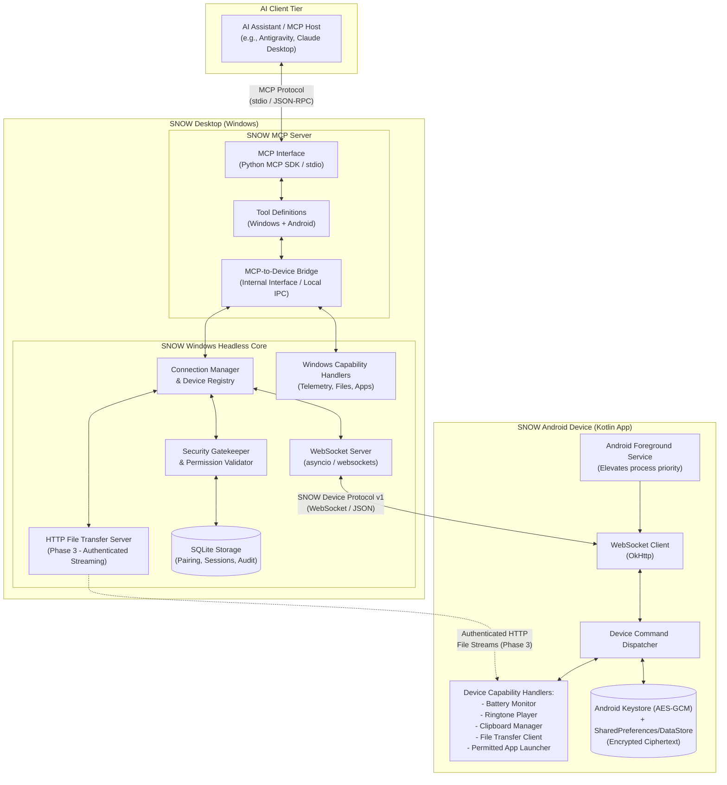
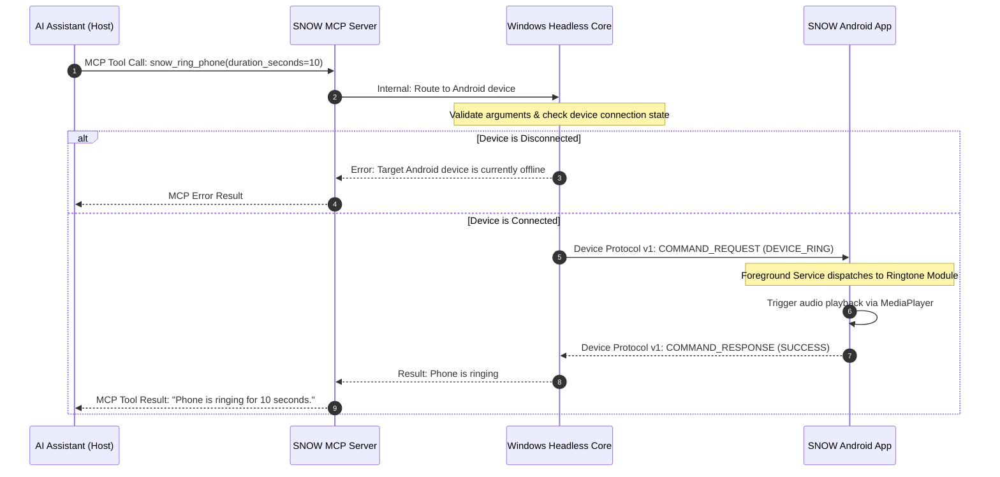

# SNOW — Architecture Specification (Frozen)

> This architecture is frozen as of Phase 0 completion. Future changes require deliberate, documented architectural decisions rather than silent implementation changes.

## 1. Project Identity and Goals

**SNOW** is a headless, cross-device AI capability bridge that allows compatible AI assistants to perform explicitly authorized operations on multiple physical devices through a standardized MCP interface.

SNOW is a B.Tech 7th-Semester Computer Science and Engineering capstone project, designed for educational clarity, incremental testability, and practical demonstration.

### 1.1 Supported Endpoints (Initial)
- **Windows laptop** — Python 3.13+ headless core (no mandatory GUI).
- **Android smartphone** — Native Kotlin application.

### 1.2 Ultimate Objective
Allow an AI assistant to interact with both the Windows laptop and the Android phone through one unified MCP interface, performing explicitly authorized operations on each device.

### 1.3 Primary Goals
1. **Headless AI Bridge**: Expose permitted device capabilities on both Windows and Android as standard MCP tools. There is no mandatory Windows GUI — the desktop core runs as a headless background process.
2. **Local-First Direct Connectivity**: Enable reliable, low-latency communication between Windows and Android over direct local connections (phone hotspot, Wi-Fi LAN) without relying on cloud infrastructure.
3. **Safety and Least Privilege**: Enforce a strict permission model, pairing mechanism, and command whitelist so that AI agents cannot execute arbitrary or destructive actions.
4. **Educational Clarity**: Maintain a clean, understandable codebase that the student can thoroughly explain, defend, and demonstrate during an academic viva.

---

## 2. High-Level Architecture and Component Separation

SNOW consists of three clearly separated components communicating through two independent protocol layers.

### 2.1 Component Overview



### 2.2 Component Responsibilities

#### SNOW MCP Server
- Exposes standardized MCP tools to compatible AI clients via the official Python MCP SDK.
- Validates permissions and requested operations before routing.
- Routes requests to the appropriate device (Windows local or Android remote) through the MCP-to-Device Bridge.
- Converts device responses into structured MCP tool results.
- Uses `stdio` transport: `stdout` is strictly reserved for MCP JSON-RPC protocol messages.

#### SNOW Windows Headless Core
- Runs as a lightweight Python 3.13+ `asyncio` background process with no mandatory GUI.
- Hosts the Connection Manager that tracks device connectivity, heartbeats, and availability.
- Hosts the WebSocket server implementing SNOW Device Protocol v1 for Android communication.
- Executes authorized Windows operations (system telemetry, scoped file operations, approved app launching).
- Communicates with the MCP Server through a defined internal interface or local IPC.
- All logging outputs to `sys.stderr` or a dedicated log file — never to `stdout`.

#### SNOW Android Client
- Built using native Kotlin with OkHttp for WebSocket communication.
- Communicates exclusively through SNOW Device Protocol v1 — does not implement an MCP server.
- Runs a Foreground Service to elevate process priority and improve connection reliability (without guaranteeing permanent connectivity).
- Implements automatic reconnection logic for Doze wakeups, screen-off states, and network transitions.
- Exposes explicitly authorized Android capabilities (battery, ringtone, clipboard, app launching, file transfer).
- Stores authentication tokens using Android Keystore-backed AES-GCM encryption with ciphertext in standard SharedPreferences or Jetpack DataStore.

### 2.3 MCP stdio Transport Logging Constraint
The MCP `stdio` transport strictly reserves standard output (`stdout`) for JSON-RPC protocol messages exchanged between the AI host and the MCP server.
- **Rule**: Never use `print()` or emit unformatted diagnostic logs to `stdout`. Doing so corrupts the JSON-RPC stream and breaks AI client communication.
- **Enforcement**: All desktop logging must be configured from Phase 1 to output exclusively to `sys.stderr` or a dedicated log file.
- **Library Auditing**: Any third-party Python library integrated into the desktop core must be configured or verified to ensure it does not write banner messages or debug text to `stdout`.

---

## 3. Protocol Separation

SNOW uses two independent communication layers that must never be coupled:

### 3.1 Layer 1: MCP Protocol (AI Client ↔ SNOW MCP Server)
- **Standard**: Model Context Protocol (MCP) via official Python MCP SDK.
- **Transport**: `stdio` (JSON-RPC over standard input/output).
- **Scope**: Tool discovery, tool invocation, and structured result delivery.
- **Direction**: Bidirectional between AI host process and SNOW MCP Server subprocess.
- MCP implementation must not be coupled to the underlying network transport (WebSocket) used for device communication.

### 3.2 Layer 2: SNOW Device Protocol v1 (Windows Core ↔ Android Client)
- **Transport**: WebSocket (`ws://` during development; `wss://` after Phase 2 security).
- **Scope**: Device command dispatch, response correlation, heartbeats, events, and connection lifecycle.
- **Direction**: Bidirectional between Windows WebSocket server and Android WebSocket client.

### 3.3 Why Separate?
1. **Decoupling AI Standards from Hardware**: MCP is an evolving protocol for LLM tool invocation. Coupling it to device sockets would bind hardware communication to AI specification changes.
2. **Defensive Validation**: The Desktop Core acts as a safety barrier. If the phone is disconnected, MCP tool calls fail fast with informative errors rather than hanging.
3. **Network Efficiency**: The device protocol is optimized for mobile constraints (lightweight JSON, low battery footprint, binary streaming offloaded to HTTP).

### 3.4 SNOW Device Protocol v1 (Wire Specification)

All communication over the WebSocket transport link conforms to **SNOW Device Protocol v1**. Messages are serialized as lightweight, UTF-8 JSON objects conforming to a standardized, versioned envelope.

#### 3.4.1 Generalized Envelope Structure

```json
{
  "version": 1,
  "type": "request | response | error | heartbeat | heartbeat_ack",
  "id": "<uuid-v4-string>",
  "timestamp": "<iso-8601-utc-string>",
  "correlation_id": "<uuid-v4-string>",
  "payload": {},
  "error": {}
}
```

> [!NOTE]
> **Clean Serialization Invariant**: Optional envelope fields (`correlation_id`, `payload`, `error`) are included in the serialized JSON **only when non-null and applicable** to the specific message type. They are never transmitted as `"field": null`.

#### 3.4.2 Envelope Field Definitions

| Field | Type | Presence | Description |
|:---|:---|:---|:---|
| `version` | `integer` | Required | Protocol version. Must be integer `1` (booleans and strings like `"1.0"` are strictly rejected). |
| `type` | `string` | Required | Message classification. Must be one of five lowercase tokens: `request`, `response`, `error`, `heartbeat`, `heartbeat_ack`. |
| `id` | `string` | Required | Unique message identifier. Must be a canonical, RFC 4122-compliant UUIDv4 string. |
| `timestamp` | `string` | Required | Timestamp of message creation in strict UTC ISO-8601 format (must end in `Z` or `+00:00` with zero offset; naive timestamps are rejected). |
| `correlation_id` | `string` | Conditional | Unique UUIDv4 identifier linking a message to its originating `request` or `heartbeat` `id`. Required on `response` and `heartbeat_ack`; optional on `error`. |
| `payload` | `object` | Conditional | Structured JSON dictionary containing action parameters or execution results. Required on `request` and `response`; omitted on `error`, `heartbeat`, and `heartbeat_ack`. |
| `error` | `object` | Conditional | Structured JSON dictionary with keys `code` (string) and `message` (string). Required on `error`; omitted on all other message types. |

#### 3.4.3 Field Requirements by Message Type

| Message Type | `version` | `type` | `id` | `timestamp` | `correlation_id` | `payload` | `error` |
|:---|:---:|:---:|:---:|:---:|:---:|:---:|:---:|
| `request` | Required (`1`) | Required (`"request"`) | Required (UUIDv4) | Required (UTC ISO) | Optional (UUIDv4) | Required (`{"action": "...", "data": {...}}`) | Omitted |
| `response` | Required (`1`) | Required (`"response"`) | Required (UUIDv4) | Required (UTC ISO) | **Required** (UUIDv4) | Required (`{"status": "...", ...}`) | Omitted |
| `error` | Required (`1`) | Required (`"error"`) | Required (UUIDv4) | Required (UTC ISO) | Optional (UUIDv4) | Omitted | Required (`{"code": "...", "message": "..."}`) |
| `heartbeat` | Required (`1`) | Required (`"heartbeat"`) | Required (UUIDv4) | Required (UTC ISO) | Optional (UUIDv4) | Omitted | Omitted |
| `heartbeat_ack` | Required (`1`) | Required (`"heartbeat_ack"`) | Required (UUIDv4) | Required (UTC ISO) | **Required** (UUIDv4) | Omitted | Omitted |

#### 3.4.4 Standardized Protocol Error Codes

When an incoming frame fails validation or an operation fails, an `error` message is generated with one of the standardized `ErrorCode` tokens:

| Error Code | Trigger Condition |
|:---|:---|
| `INVALID_JSON` | Payload syntax error or non-UTF-8 character sequence. |
| `OVERSIZED_MESSAGE` | Incoming payload size exceeds `max_message_size` (default: 65,536 bytes / 64 KB). |
| `UNSUPPORTED_VERSION` | Envelope `version` is missing, not an integer, or not equal to `1`. |
| `INVALID_MESSAGE_TYPE` | Envelope `type` is missing, not a string, or not in the allowed 5 message types. |
| `INVALID_MESSAGE_ID` | Envelope `id` is missing, empty, not a string, or not a valid UUIDv4. |
| `INVALID_CORRELATION_ID` | Required `correlation_id` is missing, or present `correlation_id` is not a valid UUIDv4. |
| `INVALID_PAYLOAD` | Missing required `payload` / `error` object, missing `action` string, or non-object `data`. |
| `INVALID_TIMESTAMP` | Missing timestamp, malformed ISO string, naive timestamp lacking timezone, or non-zero UTC offset. |
| `UNSUPPORTED_ACTION` | Requested `action` string is not supported or permitted by the target endpoint. |
| `HEARTBEAT_TIMEOUT` | Connection terminated due to exceeding client silence threshold (`heartbeat_timeout`, default 45s). |
| `INTERNAL_ERROR` | Unhandled internal exception encountered while processing message. |

#### 3.4.5 Operational Mechanics and Rules

1. **Bidirectional Request / Response Correlation**:
   - Every outbound `request` creates a unique UUIDv4 `id` and is tracked in an in-memory asynchronous table (`asyncio.Future` mapping).
   - The recipient must formulate a `response` (or `error`) setting `correlation_id` to the request's `id`.
   - The originating node matches incoming responses by `correlation_id` to resolve the pending future.
   - If no response arrives within the configured timeout (default: 30 seconds), `TimeoutError` is raised and the pending future is discarded.
2. **Heartbeats and Stale Connection Reaping**:
   - Connected endpoints periodically exchange keepalive frames (default interval: 15 seconds).
   - An endpoint sends a `heartbeat` message containing a unique UUIDv4 `id`.
   - The receiving endpoint updates its monotonic connection activity timestamp (`time.monotonic()`) and immediately replies with a `heartbeat_ack` setting `correlation_id` to the heartbeat's `id`.
   - A background connection reaper runs periodically. If an endpoint remains silent with no valid messages or heartbeats exceeding `heartbeat_timeout` (default: 45 seconds), the connection is closed with status code `1000 ("Heartbeat timeout")` and unregistered.
3. **Transport Security Boundary (Phase 1 vs Phase 2)**:
   - In Phase 1 development, communication runs over local plaintext WebSockets (`ws://`) strictly bounded to loopback/local LAN for connection lifecycle verification.
   - Cryptographic device pairing, shared secret exchange, mutual authentication, and TLS/WSS encryption are enforced in Phase 2.

#### 3.4.6 Wire Protocol Examples

**1. Command Request (`request`)**:
```json
{
  "version": 1,
  "type": "request",
  "id": "3b241101-e2bb-4255-8caf-4136c566a962",
  "timestamp": "2026-11-15T12:00:00.000000Z",
  "payload": {
    "action": "ping",
    "data": {
      "sender": "snow-client"
    }
  }
}
```

**2. Command Response (`response`)**:
```json
{
  "version": 1,
  "type": "response",
  "id": "7a353683-9b93-4e4b-9706-e7a9b0c2a71d",
  "correlation_id": "3b241101-e2bb-4255-8caf-4136c566a962",
  "timestamp": "2026-11-15T12:00:00.005000Z",
  "payload": {
    "status": "success",
    "action": "pong"
  }
}
```

**3. Error Response (`error`)**:
```json
{
  "version": 1,
  "type": "error",
  "id": "c62a8c3e-0012-4a0b-9df2-5ea54367b613",
  "correlation_id": "3b241101-e2bb-4255-8caf-4136c566a962",
  "timestamp": "2026-11-15T12:00:00.008000Z",
  "error": {
    "code": "UNSUPPORTED_ACTION",
    "message": "Action 'unauthorized_exec' is not supported."
  }
}
```

**4. Keepalive Heartbeat (`heartbeat`)**:
```json
{
  "version": 1,
  "type": "heartbeat",
  "id": "f81d4fae-7dec-41d0-a765-00a0c91e6bf6",
  "timestamp": "2026-11-15T12:00:15.000000Z"
}
```

**5. Heartbeat Acknowledgment (`heartbeat_ack`)**:
```json
{
  "version": 1,
  "type": "heartbeat_ack",
  "id": "d9b2d63d-a233-4123-8478-a62174c3e89b",
  "correlation_id": "f81d4fae-7dec-41d0-a765-00a0c91e6bf6",
  "timestamp": "2026-11-15T12:00:15.002000Z"
}
```

### 3.5 Sequence of an AI-Initiated Action



### 3.6 MCP Host Compatibility & Testing Strategy
MCP implementations and connection methods differ across AI hosts:
- **Transport Differences**: AI clients connect to MCP servers through different transport mechanisms (primarily `stdio` or SSE over HTTP). SNOW implements the local `stdio` transport.
- **Testing Workflow**:
  1. The official **MCP Inspector** tool is the primary baseline testing tool to validate JSON-RPC protocol compliance, tool schema discovery, and tool execution.
  2. Following successful Inspector testing, test compatibility with at least one actual AI host (e.g., Google Antigravity or Claude Desktop).
- **Client Variability**: Universal compatibility across all AI clients cannot be claimed, as configuration paths, environment variable propagation, and sub-process lifecycle handling vary between client applications.

---

## 4. Connection Manager and Direct Connectivity

### 4.1 Transport Priority
SNOW prioritizes direct local connections for reliability and simplicity:

| Priority | Transport | Status | Notes |
|:---:|:---|:---|:---|
| 1 | **Android Mobile Hotspot** ↔ Windows Wi-Fi | Primary for development & demo | Phone creates hotspot; laptop connects. Most reliable for controlled testing. |
| 2 | **Standard Wi-Fi LAN** | Primary alternative | Both devices on the same router/AP. Subject to AP client isolation policies. |
| 3 | **Wi-Fi Direct** | Future extension | Peer-to-peer without router. Android API complexity; evaluate feasibility later. |
| 4 | **USB** | Optional future/diagnostic | Wired connection via ADB port forwarding. Useful for debugging only. |

> **Open Decision**: Android hotspot networking behaviour varies across manufacturers and Android versions. Whether the hotspot-hosting phone can communicate with its own WebSocket server (when acting as both hotspot host and WebSocket client connecting to a laptop on that hotspot) must be empirically tested on the actual target device. Do not assume this works without testing.

### 4.2 Laptop IP Detection
The Windows Headless Core must detect its own usable IP address at startup:
- Enumerate active network interfaces programmatically (e.g., via `socket`, `netifaces`, or `psutil`).
- Identify usable IPv4 addresses, excluding loopback (`127.0.0.1`) and link-local (`169.254.x.x`) addresses.
- Display the detected IP(s) and listening port to `sys.stderr` at startup so the user knows where to point the Android client.
- **Never hardcode IP addresses** in configuration or source code. Use `0.0.0.0` for the server bind address to listen on all interfaces.

### 4.3 Android Device Discovery
Multiple discovery methods will be evaluated incrementally:

| Method | Phase | Notes |
|:---|:---:|:---|
| **Manual IP entry** | Phase 1 | Always available as a reliable fallback. User enters the desktop's IP:port displayed at startup. |
| **UDP broadcast** | Evaluate in Phase 1 | Desktop broadcasts a discovery beacon on a known port. Android listens and auto-discovers. Requires testing on hotspot networks. |
| **mDNS / DNS-SD** | Future evaluation | Standard service discovery. Android Wi-Fi power saving can block multicast when screen is off. |
| **QR code** | Evaluate in Phase 2 | Desktop displays a QR code containing connection info (IP, port, pairing token). Phone scans to connect. Requires a minimal display mechanism. |

Manual IP entry must always remain available as the primary initial testing fallback.

### 4.4 Hotspot Network Considerations
- Android hotspots typically assign the phone a gateway IP (e.g., `192.168.43.1`) and connected clients receive DHCP addresses in the same subnet.
- Do not assume that all Android hotspot configurations allow unrestricted TCP/UDP communication between connected clients. This must be tested on actual hardware.
- UDP broadcast discovery may not work on all hotspot configurations. Manual IP entry is the reliable fallback.

---

## 5. Windows Firewall Configuration

### 5.1 Development Firewall Rule
SNOW's WebSocket server (TCP port 8765) requires an inbound firewall rule for the Python 3.13 executable:

**Safety rules**:
- **Never** disable Windows Defender Firewall globally.
- **Never** blindly change an untrusted network profile to Private.
- Create a **narrowly scoped inbound rule** for the specific Python 3.13 executable and TCP port 8765.
- Restrict the rule to appropriate network profiles (Private for home Wi-Fi LAN; or Private + Public if using phone hotspot, which Windows may classify as Public).
- Restrict to local subnet scope where practical.

**Example creation** (PowerShell, run manually as Administrator only when external inbound testing is needed):
```powershell
# Resolve the exact project virtual environment Python interpreter path
$pythonPath = (Resolve-Path ".\.venv\Scripts\python.exe").Path

# Create the scoped rule (TCP port 8765, local subnet, private profile)
New-NetFirewallRule -DisplayName "SNOW WebSocket Server" `
    -Direction Inbound -Protocol TCP -LocalPort 8765 `
    -Program $pythonPath -Action Allow `
    -Profile Private `
    -RemoteAddress LocalSubnet `
    -Description "Allow inbound connections to SNOW WebSocket server (development)"
```

**Verification**:
```powershell
Get-NetFirewallRule -DisplayName "SNOW WebSocket Server" | Format-List
```

**Removal** (after project completion or when no longer needed):
```powershell
Remove-NetFirewallRule -DisplayName "SNOW WebSocket Server"
```

### 5.2 Network Profile Awareness
- When the laptop connects to the phone's hotspot, Windows may classify that network as **Public** (more restrictive). The firewall rule must account for this.
- When on a home Wi-Fi router, the network profile is typically **Private**.
- The firewall rule above uses `Private,Public` to cover both scenarios during development.

---

## 6. Security and Trust Approach

SNOW is designed for single-user local control, but security boundaries are strictly enforced to prevent unauthorized network participants or scripts from commandeering devices.

### 6.1 Phased Security Model
- **Phase 1 (Controlled Local Development Only)**:
  - Plaintext WebSocket communication (`ws://`) is used **strictly for controlled development on a trusted, private local network**.
  - *Security Reality*: Plaintext WebSocket is **not secure** against network interception, packet sniffing, or tampering.
- **Phase 2 (Pairing & Security Implementation)**:
  1. **Transport Encryption Foundation**: A 6-digit PIN transmitted over plaintext `ws://` is vulnerable to interception and does not prevent Man-in-the-Middle (MITM) attacks. Before pairing can be treated as secure, authenticated encrypted transport must be established using TLS/WSS (e.g., pinned certificates or local TLS). Custom cryptographic protocols must never be invented.
  2. **Protected PIN Pairing**: The desktop generates a one-time 6-digit pairing PIN (or QR code) with strict time-based expiry (e.g., 60 seconds) and attempt rate-limiting (e.g., lock out after 3 failed attempts) to prevent brute-force attacks.
  3. **Token Exchange & Secure Storage**: Upon successful authenticated PIN verification, the desktop generates an authorization token stored in local SQLite. On Android, an AES key generated in the hardware-backed **Android Keystore** with **AES-GCM** authenticated encryption protects the token; encrypted ciphertext is stored in standard `SharedPreferences` or Jetpack `DataStore`. Plaintext keys are never stored in SharedPreferences, DataStore, or source code. Deprecated `EncryptedSharedPreferences` is deliberately avoided.
  4. **Connection Handshake**: Every subsequent WebSocket connection requires an authentication handshake message presenting the valid token within 5 seconds of connection establishment, or the connection is dropped.

### 6.2 Command Whitelisting
To prevent unrestricted system compromise:
- **No Remote Shell**: SNOW strictly rejects any capability that allows execution of arbitrary shell commands — on Windows (`cmd.exe`, `powershell`) or Android (`Runtime.getRuntime().exec`, `sh`).
- **App Launch Whitelist**: Both Windows and Android only launch applications explicitly approved by the user.
- **Scoped File Operations**: File read/write operations are restricted to explicitly configured directories. No unrestricted filesystem traversal.
- **Explicit User Initiation for Sensitive Ops**: Operations such as reading the Android clipboard require active user confirmation or explicit UI triggers in compliance with Android security restrictions.

### 6.3 Local and Remote AI Access

#### Local Direct Control (MVP Scope)
- Phone hotspot or Wi-Fi LAN connectivity.
- Local MCP host runs on the same machine as the Windows Headless Core.
- Device communication is restricted to the local network.

#### Future Remote AI Control (Not Phase 1)
- Secure remote MCP endpoint or private networking tunnel.
- Authenticated and authorized access with explicit user approval.
- Raw device-control ports (WebSocket, HTTP file server) must never be directly exposed to the public internet.
- Remote access is an explicitly separate future phase requiring its own security review.

---

## 7. Android Platform Realities and Technical Limitations

Building reliable Android background services requires navigating modern Android security and power-management restrictions:

| Restriction Area | Android Platform Limitation | SNOW Architectural Mitigation |
| :--- | :--- | :--- |
| **Background Execution, Doze & OEM Limits** | Android aggressively manages power via Doze Mode, App Standby Buckets, and OEM-specific background process killers (e.g., MIUI, OneUI). A Foreground Service improves execution longevity and visibility, but **does not guarantee permanent connectivity or uninterrupted background execution**. Network switches or deep idle can drop sockets. | Run a **Foreground Service** with an ongoing notification to elevate process priority. Implement resilient client-side automatic reconnection logic. Screen-off and background reconnection behaviour must be tested empirically on the physical target device. |
| **Background Clipboard Access** | Starting in Android 10 (API 29), background apps **cannot** read clipboard data unless they are the default input method (IME) or have active window focus. | Write operations to clipboard succeed; for read operations, SNOW uses an explicit user-initiated trigger (e.g., in-app button or notification action) to push clipboard content from phone to PC, rather than attempting silent background reading. |
| **Background Activity Launch Restrictions** | Android 10+ (API 29+) strictly restricts starting Activities directly from background services. `FLAG_ACTIVITY_NEW_TASK` is merely an Intent flag for task stack placement; **it is not a permission or bypass for background launch restrictions**. Full-screen intent notifications are subject to OS restrictions and reserved for eligible use cases (alarms, calls). `SYSTEM_ALERT_WINDOW` is a sensitive special permission and cannot be treated as a universal solution. | For SNOW, implement a **user-mediated notification-based launch flow**: when an app launch command is received while in the background, the service posts a notification that the user explicitly taps to open the permitted application. Direct launches are only attempted when the SNOW app is already in the foreground. |
| **Ringtone & Audio Focus** | If the phone is set to "Do Not Disturb" (DnD) or silent mode, standard media streams may be muted. | Use `AudioAttributes.USAGE_ALARM` with `STREAM_ALARM` so alerts can bypass standard media volume muting, or prompt for notification policy access if overriding DnD is necessary. |
| **Storage & File Access** | Scoped Storage (Android 11+, API 30+) prohibits direct unrestricted filesystem access. | Files transferred to the phone are saved to standard public directories (e.g., `Downloads/SNOW`) using `MediaStore` or `Storage Access Framework` (SAF). |
| **Local Network Discovery** | Android Wi-Fi power saving often blocks multicast/mDNS packets when the screen is off. | Initial phases rely on **manual IP configuration**. Automatic discovery methods (UDP broadcast, mDNS) are evaluated incrementally with manual fallback always available. |

---

## 8. MVP Scope and Excluded Features

### 8.1 In-Scope MVP Features
1. **Direct Local Connectivity**: Reliable WebSocket communication between Windows and Android over phone hotspot and Wi-Fi LAN.
2. **Windows System Telemetry**: Battery status, CPU/RAM usage, running process information via MCP tools.
3. **Android Device State Queries**: Battery percentage, charging status, and connection health.
4. **Find My Phone Alert**: Triggering an audible alert/ringtone on the phone on command.
5. **Clipboard Sharing**: Pushing text between Windows and Android with explicit user initiation.
6. **Authenticated File Transfer**: Bidirectional file transfer using HTTP streaming with SHA-256 integrity verification.
7. **Controlled App Launcher**: Launching explicitly permitted applications on both Windows and Android.
8. **Scoped File Operations**: Reading/writing files within configured directories on both devices.
9. **Unified MCP Tools**: Standardized MCP tools exposing both Windows and Android capabilities to AI assistants.
10. **Device Pairing & Security**: PIN/QR pairing, TLS/WSS transport, AES-GCM token storage.

### 8.2 Explicitly Excluded Features (Out of Scope)
- **Mandatory Windows GUI**: SNOW Desktop runs headless. A GUI is not required for core functionality.
- **Cloud Relays & Internet Routing**: No external servers, STUN/TURN, AWS/GCP, or remote access outside the local network.
- **Unrestricted Shell / Terminal Control**: No remote shell execution, ADB bridge, or root privileges.
- **Screen Mirroring & Remote Input Injection**: No raw screen streaming, mouse injection, or Accessibility-based remote bot clicks.
- **Complex Enterprise Infrastructure**: No Docker, Kubernetes, microservices, message queues, or heavy databases.
- **Custom Cryptographic Primitives**: Use only standard libraries (`hashlib`, `hmac`, `secrets`, Java `KeyStore`, AES-GCM).
- **Complex Multi-Device Fleet Management**: Exactly one laptop and one smartphone paired simultaneously in the initial MVP.

---

## 9. Frozen Technology Decisions

These decisions are final and must not be silently changed:

| Area | Final Decision |
|:---|:---|
| Windows runtime | Python 3.13 |
| Desktop architecture | `asyncio` (headless, no mandatory GUI) |
| Android | Native Kotlin |
| Initial transport | WebSocket |
| Device protocol | SNOW Device Protocol v1 |
| MCP | Official Python MCP SDK |
| Desktop database | SQLite |
| Android secure storage | Android Keystore (AES-GCM key) + SharedPreferences/DataStore (ciphertext) |
| Encryption | AES-GCM |
| File integrity | SHA-256 |
| Logging | `sys.stderr` only (never `stdout`) |
| MCP stdio | `stdout` reserved exclusively for protocol messages |
| Permissions | Explicit command whitelisting |
| Arbitrary shell execution | Prohibited |
| Windows GUI | Not mandatory |
| Deprecated Android crypto | `EncryptedSharedPreferences` — **deliberately avoided** |
