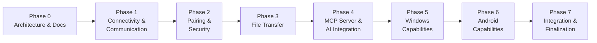

# SNOW — Project Implementation Roadmap (Frozen)

> This roadmap is frozen as of Phase 0 completion. Phase ordering, dependencies, and scope boundaries must not be silently changed.

This document outlines the step-by-step, milestone-based development plan for **SNOW**, designed specifically for a single B.Tech Computer Science student completing a 7th-semester capstone project.

Each phase is self-contained, testable, and builds incrementally on previous accomplishments. No phase assumes features work without direct testing. Security is established before device capabilities are implemented.

---

## Roadmap Overview

---

## Phase 0: Architecture and Documentation

### Concept Explained
Before writing code, establish a clear blueprint and prepare development tools so that no architectural confusion or dependency conflicts arise later. This phase produces the frozen architecture specification, implementation roadmap, and agent working rules.

### Objectives
- Define and freeze the project architecture, component boundaries, and technical constraints.
- Create coding-agent working guidelines to maintain discipline throughout development.
- Document environment prerequisites and verification steps.
- Perform a final cross-document consistency audit.

### Deliverables
- `ARCHITECTURE.md`: Frozen system architecture and protocol design.
- `ROADMAP.md`: This comprehensive milestone plan.
- `AGENTS.md`: Agent operational guidelines and safety rules.

### Dependencies
- None (first phase).

### Acceptance Criteria
- [x] All three core documentation files exist in workspace root and are internally consistent.
- [x] Clear scope boundaries established (headless desktop, no cloud, no unrestricted shell, local connectivity).
- [x] Technology decisions table is frozen.
- [x] Phase ordering is finalized with explicit dependencies.
- [x] Student understands the high-level role of each component.

### Viva Concept Check
- **What is SNOW?** A headless, cross-device AI capability bridge that lets AI assistants perform authorized operations on a Windows laptop and Android phone through a unified MCP interface.
- **Why no mandatory Windows GUI?** SNOW's desktop core is a headless bridge — AI assistants interact via MCP, and the user interacts via the Android app. A GUI would add complexity without core value.
- **Why avoid cloud infrastructure?** Local-first reduces latency, eliminates hosting costs, preserves privacy, and simplifies networking for a semester project.

---

## Phase 1: Direct Connectivity and Communication

### Concept Explained
This phase builds the entire end-to-end communication pipeline: a Python headless desktop core, the WebSocket-based device protocol, a real Android client, and physical device connectivity testing. By the end of Phase 1, the laptop and phone can exchange messages reliably over a phone hotspot or Wi-Fi LAN.

---

### Sub-Milestone 1.1: Python 3.13 Headless Core

#### Concept Explained
The desktop core must handle asynchronous operations — listening for connections, handling commands, and managing timeouts — without freezing. Python's `asyncio` is the standard for this event-driven architecture. Because this core will support the MCP `stdio` transport, `stdout` is strictly reserved for JSON-RPC. All logging goes to `sys.stderr`.

#### Objectives
- Set up a clean, isolated Python 3.13 virtual environment using `py -3.13 -m venv .venv`.
- Implement an asynchronous server scaffold using `asyncio`.
- Build graceful startup, clean signal handling (`SIGINT`/`Ctrl+C`), and configure Python logging strictly to `sys.stderr`.
- Implement network interface detection: enumerate active interfaces, identify usable IPv4 addresses, exclude loopback and link-local.
- Display detected IP(s) and listening port to `sys.stderr` at startup.
- Enforce: zero `print()` or unstructured output to `stdout`.

#### Deliverables
- `pyproject.toml` with minimal dependencies and Python 3.13 requirement.
- `src/snow/core/config.py`: Centralized configuration (bind address, ports, log level).
- `src/snow/core/server.py`: Async server lifecycle manager with graceful shutdown and `sys.stderr` logging.
- `src/snow/core/network.py`: Network interface detection and IPv4 address enumeration.
- `src/snow/main.py`: Entry point for starting the desktop service.
- Verification script to test startup, shutdown, IPv4 detection, and stdout cleanliness.

#### Dependencies
- Completion of Phase 0.
- Python 3.13 installed on Windows (`py -3.13 --version` succeeds).

#### Acceptance Criteria
- [x] Running `py -3.13 -m snow.main` (from within the venv) starts the async core loop, logs structured startup messages strictly to `sys.stderr`, displays detected IPv4 addresses, and responds cleanly to `Ctrl+C`.
- [x] Zero bytes are emitted to `stdout` during startup and operation.
- [x] IPv4 detection correctly identifies the active network interface IP (not `127.0.0.1` or `169.254.x.x`).

#### Viva Concept Check
- **What is an event loop in `asyncio`?** A single-threaded loop that coordinates asynchronous tasks, callbacks, and I/O events cooperatively.
- **Why `asyncio` instead of threading?** Network I/O (WebSockets) is mostly waiting on sockets; coroutines use less memory and eliminate race conditions.
- **Why must logging use `sys.stderr`?** The MCP `stdio` transport uses `stdout` for JSON-RPC protocol frames. Any stray output on `stdout` corrupts the AI host communication.

---

### Sub-Milestone 1.2: WebSocket Server and SNOW Device Protocol v1

#### Concept Explained
The desktop runs a WebSocket server that speaks SNOW Device Protocol v1 — a versioned JSON envelope format for commands, responses, heartbeats, and events. Before building the Android client, we validate the protocol using a lightweight Python mock client.

#### Objectives
- Implement the WebSocket server on `0.0.0.0:8765` using `asyncio` and the `websockets` library.
- Implement SNOW Device Protocol v1 envelope parser and validator using `pydantic`.
- Create a mock Android client in Python that connects, responds to heartbeats, and simulates command responses.
- Implement heartbeat/keepalive (15-second interval, 45-second dead timeout).
- Implement correlation ID matching for request/response pairs with configurable timeout (30 seconds).
- Configure the Windows Firewall rule for the Python 3.13 executable on TCP port 8765.

#### Deliverables
- `src/snow/protocol/`: Protocol constants, models, and strict validator (`constants.py`, `models.py`, `validator.py`).
- `src/snow/network/ws_server.py`: Async WebSocket server with connection handling and bidirectional command routing.
- `src/snow/network/connection_manager.py`: Tracks connected device state (ID, IP, last heartbeat, online/offline status).
- `tests/mock_device.py`: Python CLI mock client supporting ping/pong and generic request/response protocol verification.
- Windows Firewall rule documentation and verification commands.

#### Dependencies
- Completion of Sub-Milestone 1.1.

#### Acceptance Criteria
- [x] Mock client connects over WebSocket to Desktop Core on `ws://<laptop-ip>:8765` (or `ws://127.0.0.1:8765`).
- [x] Bidirectional request/response correlation verified via generic protocol test (`send_request()` matches correlated response `id`; physical Android device capabilities remain unverified until later phases).
- [x] Heartbeats exchange periodically; killing or idling mock client triggers offline reaping after heartbeat timeout.
- [x] Correlation IDs correctly match requests to responses.
- [ ] Windows Firewall rule documented (must be manually created in an elevated PowerShell session when needed; physical firewall rule configuration remains unverified).

#### Viva Concept Check
- **Why WebSockets instead of HTTP polling?** WebSockets provide a persistent, full-duplex TCP channel; the server can push commands to the phone instantly.
- **How do correlation IDs work?** Each request has a unique `id`. The client echoes that `id` in its response, allowing the server to match async responses to waiting requests.
- **Why a firewall rule?** Windows Defender Firewall blocks unsolicited inbound connections by default. A scoped rule allows only SNOW's specific Python process and port.

---

### Sub-Milestone 1.3: Minimal Kotlin Android Connectivity Client

#### Concept Explained
Replace the Python mock client with a real native Android application. The app connects to the desktop's IP address, maintains a WebSocket connection through a Foreground Service, and displays live connection status.

#### Objectives
- Create a clean Android Studio project in Kotlin (Min SDK 26, Target SDK 34/35).
- Build a single-screen UI with:
  - Desktop IP and Port configuration inputs.
  - "Connect" / "Disconnect" button.
  - Live connection status indicator (Connected, Connecting, Disconnected).
  - Simple event/activity log view.
- Implement an OkHttp-based WebSocket client inside an Android Foreground Service with a persistent notification.
- Implement protocol v1 heartbeat handling.
- Implement automatic reconnection logic with exponential backoff.

#### Deliverables
- Android Studio project: `android/` directory.
- `android/.../network/SnowWebSocketClient.kt`: OkHttp WebSocket wrapper with reconnection.
- `android/.../service/SnowForegroundService.kt`: Foreground Service managing connection lifecycle.
- `android/.../protocol/MessageModels.kt`: Kotlin data classes matching Device Protocol v1 envelopes.
- `android/.../ui/MainActivity.kt`: User interface.

#### Dependencies
- Completion of Sub-Milestone 1.2.
- Android Studio installed; physical Android phone with Developer Mode and USB debugging enabled.

#### Acceptance Criteria
- Android app connects to the desktop WebSocket server using manually entered IP:port.
- Desktop logs show the real phone's IP and connection time.
- Heartbeats exchange correctly between desktop and phone.
- Disconnecting Wi-Fi on the phone triggers reconnection attempts with backoff; reconnecting Wi-Fi restores the connection.

#### Viva Concept Check
- **Why a Foreground Service?** Android aggressively kills background tasks. A Foreground Service with a visible notification elevates process priority, though it does not guarantee permanent connectivity.
- **What is OkHttp?** A robust HTTP & WebSocket client library for Android and Java applications.

---

### Sub-Milestone 1.4: Physical Connectivity and Discovery Testing

#### Concept Explained
Verify that the laptop and phone can actually communicate over real-world network configurations. This is empirical testing — results depend on the specific hardware and Android version.

#### Objectives
- Test connectivity over phone's mobile hotspot (phone creates hotspot; laptop connects; verify WebSocket communication).
- Test connectivity over standard Wi-Fi LAN (both devices on same router).
- Test UDP broadcast discovery feasibility on each network type.
- Document any network-specific issues (AP client isolation, hotspot restrictions).
- Evaluate QR code connection information delivery.

#### Deliverables
- `docs/CONNECTIVITY_TEST_RESULTS.md`: Documented test results for each network configuration on actual hardware.
- Updates to Connection Manager if hotspot-specific behaviour requires adaptation.

#### Dependencies
- Completion of Sub-Milestone 1.3.
- Physical Android phone and Windows laptop available.

#### Acceptance Criteria
- At least one connectivity method (hotspot or Wi-Fi LAN) reliably establishes and maintains a WebSocket connection between the physical devices.
- Test results document which network configurations work, which have limitations, and why.
- Any connectivity workarounds are documented.

#### Viva Concept Check
- **Why test on physical hardware?** Network behaviour (hotspot routing, AP isolation, firewall rules) varies by manufacturer and environment. Simulated tests cannot validate real-world connectivity.
- **What is AP client isolation?** A router security feature that prevents connected Wi-Fi clients from communicating with each other directly. It breaks device-to-device protocols.

---

### Sub-Milestone 1.5: Reconnection and Reliability Testing

#### Concept Explained
Stress-test the connection lifecycle under real-world disruption scenarios to ensure the system recovers gracefully.

#### Objectives
- Test connection recovery after: phone screen off → screen on, brief Wi-Fi dropout, airplane mode toggle, phone app force-stop and restart, laptop sleep/wake.
- Measure reconnection time and verify state consistency.
- Document any scenarios where the Foreground Service fails to maintain or recover the connection.

#### Deliverables
- Updated reconnection logic if testing reveals gaps.
- Reliability test results added to `docs/CONNECTIVITY_TEST_RESULTS.md`.

#### Dependencies
- Completion of Sub-Milestone 1.4.

#### Acceptance Criteria
- Connection recovers automatically within 30 seconds after screen-off/screen-on and brief Wi-Fi dropout.
- After airplane mode toggle, reconnection occurs within 60 seconds of network restoration.
- Force-stopping and reopening the Android app re-establishes the connection.
- All failure modes are documented with observed behaviour.

#### Viva Concept Check
- **Does a Foreground Service guarantee the WebSocket stays alive during Doze?** No. Deep Doze restricts network access. The client must implement reconnection logic and test behaviour empirically on the target device.

---

## Phase 2: Pairing and Security

### Concept Explained
Before enabling device capabilities, we must secure the communication channel. Transmitting credentials over plaintext `ws://` is vulnerable to sniffing and MITM attacks. Phase 2 establishes device identity, encrypted transport, and authenticated sessions.

---

### Sub-Milestone 2.1: Device Identity and Pairing

#### Objectives
- Generate a unique device identity (UUID) for each endpoint on first run.
- Implement a 6-digit PIN pairing flow: desktop displays PIN; user enters it on the Android app.
- Enforce PIN expiry (60 seconds) and rate limiting (3 failed attempts → lockout).
- Evaluate QR code as an alternative/supplement to manual PIN entry.

#### Deliverables
- `src/snow/security/identity.py`: Device identity generation and persistence.
- `src/snow/security/pairing.py`: PIN generation, expiry, and rate limiting.
- `android/.../security/PairingFlow.kt`: PIN entry UI and verification.
- Pairing protocol messages (`PAIR_REQUEST`, `PAIR_CHALLENGE`, `PAIR_RESPONSE`).

#### Dependencies
- Completion of Phase 1 (all sub-milestones).

#### Acceptance Criteria
- Desktop generates and displays a 6-digit PIN on `sys.stderr`.
- Entering the correct PIN within 60 seconds pairs the devices.
- Entering incorrect PIN 3 times triggers lockout.
- Expired PINs are rejected with a clear error.

#### Viva Concept Check
- **Why use a 6-digit PIN?** Out-of-band authentication establishes initial trust between devices. The user physically verifies both endpoints.
- **Why enforce expiry and rate limiting?** Short-lived PINs reduce the window for brute-force attacks. Rate limiting prevents automated guessing.

---

### Sub-Milestone 2.2: SQLite Pairing Records and Session Management

#### Objectives
- Store paired device records (device ID, display name, pairing timestamp, auth token hash) in SQLite.
- Implement session management: track active sessions, support device unpairing.
- Log pairing events for audit.

#### Deliverables
- `src/snow/security/db.py`: SQLite schema and data access for pairing records and session state.
- Unpair command support in the device protocol.

#### Dependencies
- Completion of Sub-Milestone 2.1.

#### Acceptance Criteria
- `snow_devices.db` correctly records paired device ID, name, and token hash.
- Unpairing a device removes its record and rejects subsequent connection attempts.
- Database file is added to `.gitignore`.

#### Viva Concept Check
- **Why SQLite?** Lightweight, embedded, zero-configuration database. Perfect for single-user local storage without requiring a database server.

---

### Sub-Milestone 2.3: Android Keystore and AES-GCM Credential Storage

#### Objectives
- Generate an AES encryption key inside the hardware-backed Android Keystore.
- Encrypt pairing tokens using AES-GCM authenticated encryption.
- Store encrypted ciphertext in standard SharedPreferences or Jetpack DataStore.
- Never store plaintext keys in SharedPreferences, DataStore, or source code.

#### Deliverables
- `android/.../security/KeyStoreManager.kt`: Keystore key generation and AES-GCM encrypt/decrypt wrapper.
- `android/.../security/TokenStorage.kt`: Encrypted token persistence in SharedPreferences/DataStore.

#### Dependencies
- Completion of Sub-Milestone 2.2.

#### Acceptance Criteria
- Token encryption uses a Keystore-managed AES key with AES-GCM.
- Ciphertext is stored in SharedPreferences/DataStore; plaintext key is never written to disk.
- Tampering with the stored ciphertext causes decryption to fail with an authentication error.

#### Viva Concept Check
- **How does Android Keystore protect keys?** Keys are generated and stored inside a hardware-isolated security module (TEE/StrongBox). They cannot be extracted, even by a rooted device.
- **Why AES-GCM?** Authenticated encryption: it provides both confidentiality (encryption) and integrity (authentication tag), detecting any tampering.

---

### Sub-Milestone 2.4: Authenticated Communication and TLS/WSS

#### Objectives
- Implement TLS/WSS transport for the WebSocket connection.
- Implement token-based authentication in the connection handshake: the client must present a valid auth token within 5 seconds of connection, or the connection is dropped.
- Evaluate certificate pinning or local self-signed certificates for transport encryption.

#### Deliverables
- TLS configuration for the Python WebSocket server.
- Updated Android client with WSS support.
- `AUTH_REQUEST` and `AUTH_VERIFY` handshake messages in the device protocol.
- Test script verifying unauthenticated connections are rejected.

#### Dependencies
- Completion of Sub-Milestone 2.3.

#### Acceptance Criteria
- Communication occurs over `wss://` (encrypted).
- Unauthenticated connections are rejected within 5 seconds.
- Paired devices authenticate automatically using stored tokens.
- An unpaired device cannot communicate even if it knows the IP:port.

#### Viva Concept Check
- **Why is TLS mandatory before treating pairing as secure?** Without TLS, the PIN, token exchange, and all subsequent commands travel in plaintext and can be intercepted by any observer on the network.

---

## Phase 3: Reliable File Transfer

### Concept Explained
File transfer uses authenticated HTTP streaming — large binary payloads are deliberately kept off the WebSocket control channel. This phase implements bidirectional file transfer with integrity verification.

---

### Sub-Milestone 3.1: Authenticated Bidirectional HTTP Streaming

#### Objectives
- Implement a lightweight HTTP server on the desktop for file uploads and downloads, authenticated using the pairing session token.
- Implement file download (desktop → Android) and file upload (Android → desktop) over HTTP streaming.
- Never transfer large file contents as Base64 through WebSocket messages.

#### Deliverables
- `src/snow/transfer/http_server.py`: Authenticated HTTP file transfer server.
- `android/.../transfer/FileTransferClient.kt`: HTTP streaming download/upload client.
- Device protocol messages for file transfer coordination (metadata exchange via WebSocket; binary transfer via HTTP).

#### Dependencies
- Completion of Phase 2 (authenticated communication established).

#### Acceptance Criteria
- A test file transfers successfully from desktop to phone's `Downloads/SNOW` directory.
- A test file transfers from phone to a configured desktop directory.
- Unauthenticated HTTP requests are rejected.

#### Viva Concept Check
- **Why HTTP streaming instead of WebSocket Base64?** Base64 encoding increases payload size by ~33% and large frames can block the real-time control channel. HTTP streaming handles large files efficiently with chunked transfer encoding.

---

### Sub-Milestone 3.2: SHA-256 Integrity Verification

#### Objectives
- Compute SHA-256 hash of files before and after transfer.
- Include the hash in the transfer metadata message sent via WebSocket.
- Verify the hash on the receiving end; reject corrupted transfers.

#### Deliverables
- Hash computation and verification integrated into file transfer flow.
- Transfer metadata includes file size and SHA-256 hash.

#### Dependencies
- Completion of Sub-Milestone 3.1.

#### Acceptance Criteria
- Transferred files have matching SHA-256 hashes on source and destination.
- Deliberately corrupting a transferred file (by modifying bytes in transit) triggers a verification failure.

#### Viva Concept Check
- **What is SHA-256?** A cryptographic hash function producing a 256-bit digest. Any change to the input produces a completely different hash, enabling integrity verification.

---

### Sub-Milestone 3.3: Interrupted Transfer Handling and Cleanup

#### Objectives
- Handle transfers interrupted by network disconnection, app kill, or timeout.
- Clean up partial/incomplete files on the receiving end.
- Report transfer failures through the device protocol.

#### Deliverables
- Cleanup logic for incomplete transfers.
- Timeout handling for stalled transfers.
- Error reporting through device protocol and MCP tool results.

#### Dependencies
- Completion of Sub-Milestone 3.2.

#### Acceptance Criteria
- Killing the connection mid-transfer does not leave orphaned partial files.
- Transfer timeout produces a clear error message.

#### Viva Concept Check
- **Why clean up partial files?** Incomplete files can confuse users and waste storage. A robust transfer system ensures either a complete verified file or a clean failure.

---

### Sub-Milestone 3.4: Resume Support and Duplicate Prevention

#### Objectives
- Implement transfer resume for large files using HTTP Range headers.
- Implement duplicate detection using SHA-256 hash comparison to avoid re-transferring identical files.

#### Deliverables
- HTTP Range header support in file transfer server and client.
- Duplicate detection logic comparing file hashes before transfer.

#### Dependencies
- Completion of Sub-Milestone 3.3.

#### Acceptance Criteria
- Interrupting and resuming a large file transfer completes successfully with correct SHA-256.
- Attempting to transfer an already-present identical file (same hash) skips the transfer and reports "already exists."

#### Viva Concept Check
- **How do HTTP Range headers enable resume?** The client requests bytes starting from where the previous transfer stopped (`Range: bytes=<offset>-`). The server responds with the remaining content.

---

## Phase 4: MCP Server and AI Integration

### Concept Explained
The Model Context Protocol (MCP) allows AI clients to discover and invoke tools. In this phase, we connect the official Python MCP SDK to the desktop core, creating a unified interface for both Windows and Android capabilities.

---

### Sub-Milestone 4.1: Official Python MCP SDK Integration

#### Objectives
- Implement an MCP server using the official Python MCP SDK over `stdio` transport.
- Configure `stdout` to be exclusively reserved for MCP JSON-RPC protocol messages.
- Implement a basic tool (`snow_get_device_status`) to validate the SDK integration.

#### Deliverables
- `src/snow/mcp/server.py`: MCP Server implementation.
- `src/snow/mcp/tools.py`: Tool definitions with docstrings and type annotations.
- Verification using MCP Inspector.

#### Dependencies
- Completion of Phase 3 (secure, authenticated communication pipeline in place).

#### Acceptance Criteria
- MCP Inspector discovers and lists the `snow_get_device_status` tool.
- Calling the tool returns the current connection status of paired devices.
- Zero non-protocol bytes appear on `stdout`.

#### Viva Concept Check
- **What is MCP?** An open standard that lets AI applications discover and invoke external tools, prompts, and data sources through a consistent protocol.
- **Why `stdio` transport?** The AI host launches the MCP server as a child process and communicates via stdin/stdout, which is the standard local transport.

---

### Sub-Milestone 4.2: MCP-to-Device-Protocol Bridge and Local IPC

#### Objectives
- Implement the bridge layer that translates MCP tool calls into SNOW Device Protocol v1 commands and routes them to the appropriate device.
- For Windows-local operations, the bridge calls local capability handlers directly.
- For Android operations, the bridge routes through the Connection Manager and WebSocket.

#### Deliverables
- `src/snow/mcp/bridge.py`: MCP-to-device routing and translation layer.
- Updated Connection Manager to support bridge queries.

#### Dependencies
- Completion of Sub-Milestone 4.1.

#### Acceptance Criteria
- MCP tool calls correctly route to Android device (via WebSocket) or Windows local handlers.
- When the Android device is offline, Android-targeted tools return informative error messages.
- When a Windows tool is called, it executes locally without requiring the Android device.

#### Viva Concept Check
- **Why separate the bridge from the MCP server?** The bridge handles routing logic (which device? is it online?) while the MCP server handles protocol compliance. Separation keeps each component focused and testable.

---

### Sub-Milestone 4.3: Unified Windows and Android Tool Definitions

#### Objectives
- Define the complete set of MCP tool schemas for both Windows and Android capabilities.
- Include clear tool descriptions, parameter types, and device-target annotations for AI assistants.

#### Deliverables
- Complete tool definitions in `src/snow/mcp/tools.py` covering:
  - Windows: `snow_windows_battery`, `snow_windows_system_info`, `snow_windows_processes`, `snow_windows_launch_app`, `snow_windows_file_read`, `snow_windows_file_write`, `snow_windows_file_list`.
  - Android: `snow_android_battery`, `snow_android_ring`, `snow_android_clipboard_push`, `snow_android_launch_app`, `snow_android_list_apps`, `snow_android_file_send`, `snow_android_file_receive`.
  - General: `snow_get_device_status`, `snow_list_devices`.
- Tool documentation sufficient for an AI assistant to understand usage.

#### Dependencies
- Completion of Sub-Milestone 4.2.

#### Acceptance Criteria
- All tool schemas are discoverable via MCP Inspector.
- Tool descriptions clearly indicate which device they target.
- Calling each tool returns appropriate results (or informative errors).

#### Viva Concept Check
- **Why prefix tools with `snow_windows_` and `snow_android_`?** Namespace prefixes help the AI assistant understand which device a tool targets, preventing ambiguous invocations.

---

### Sub-Milestone 4.4: MCP Inspector and AI Client Verification

#### Objectives
- Validate all MCP tools using the official MCP Inspector.
- Test compatibility with at least one actual AI host (e.g., Google Antigravity or Claude Desktop).
- Document any client-specific configuration requirements.

#### Deliverables
- MCP Inspector test report.
- AI host compatibility test report.
- Configuration documentation for tested AI hosts.

#### Dependencies
- Completion of Sub-Milestone 4.3.

#### Acceptance Criteria
- All tools pass MCP Inspector validation (schema discovery, invocation, result format).
- At least one AI host successfully discovers and invokes SNOW tools.
- Any compatibility issues are documented with workarounds.

#### Viva Concept Check
- **Does an MCP server guarantee compatibility with all AI clients?** No. Clients differ in supported transports, sub-process management, and environment handling. Testing verifies specific client compatibility.

---

## Phase 5: Windows Control Capabilities

### Concept Explained
Implement authorized Windows operations that the AI assistant can invoke through MCP tools. All operations are explicitly scoped — no arbitrary shell execution or unrestricted filesystem access.

### Objectives
- System telemetry: battery status, CPU/RAM usage.
- Process monitoring: list running processes with resource usage.
- Scoped file operations: read, write, and list files within configured directories only.
- Approved application launching: launch only applications on an explicit user-configured whitelist.

### Deliverables
- `src/snow/capabilities/windows/telemetry.py`: System battery, CPU, RAM information.
- `src/snow/capabilities/windows/processes.py`: Running process enumeration.
- `src/snow/capabilities/windows/files.py`: Scoped file read/write/list.
- `src/snow/capabilities/windows/apps.py`: Whitelisted application launcher.
- Corresponding MCP tool implementations and tests.

### Dependencies
- Completion of Phase 4 (MCP server and bridge functional).

### Acceptance Criteria
- `snow_windows_battery` returns current battery percentage and charging state.
- `snow_windows_system_info` returns CPU usage percentage and RAM usage.
- `snow_windows_processes` returns a list of running processes.
- `snow_windows_file_list` lists files only within configured allowed directories; requests outside those directories are rejected.
- `snow_windows_launch_app` launches only whitelisted applications; non-whitelisted requests are rejected with a clear error.
- All operations log to `sys.stderr`.

### Viva Concept Check
- **Why whitelist applications instead of allowing arbitrary launches?** Arbitrary program execution is a critical security risk. An AI assistant (or compromised prompt) could launch malware, delete files, or escalate privileges. Whitelisting restricts launches to user-approved, known-safe applications.
- **Why scope file operations to configured directories?** Unrestricted filesystem access would allow reading sensitive files (passwords, keys) or writing to system directories. Scoping protects the user's system.

---

## Phase 6: Android Control Capabilities

### Concept Explained
Implement authorized Android device capabilities, each verified with tests and then exposed as MCP tools through the desktop bridge. All capabilities respect Android platform restrictions documented in the architecture.

### Sub-Milestones:

#### Milestone 6.1: Battery Information
- Android: Query `BatteryManager` (percentage, plugged status, health).
- MCP Tool: `snow_android_battery`.

#### Milestone 6.2: Ring Phone / Find My Phone
- Android: Play alarm ringtone using `RingtoneManager` or `MediaPlayer` for a specified duration.
- Use `AudioAttributes.USAGE_ALARM` with `STREAM_ALARM` to bypass silent mode where possible.
- MCP Tool: `snow_android_ring(duration_seconds)`.

#### Milestone 6.3: User-Authorized Clipboard Operations
- Android: User-initiated push (phone → desktop) via in-app button or notification action.
- Desktop → phone: write to clipboard via device protocol command.
- Background clipboard reading is not attempted (Android 10+ restriction).
- MCP Tool: `snow_android_clipboard_push(text)`.

#### Milestone 6.4: User-Mediated Application Launching
- Android: App whitelist configured in the Android app settings.
- Compliant with Android 10+ background activity launch restrictions:
  - When in background: post a notification that the user taps to launch the app.
  - Direct launch only attempted when SNOW is already foregrounded.
  - `FLAG_ACTIVITY_NEW_TASK` is an Intent flag, not a background launch bypass.
  - Full-screen intents and `SYSTEM_ALERT_WINDOW` are not used as general solutions.
- MCP Tools: `snow_android_list_apps()`, `snow_android_launch_app(app_name)`.

#### Milestone 6.5: Android File Operations
- Receive files from desktop via authenticated HTTP streaming (Phase 3 infrastructure).
- Send files from phone to desktop via authenticated HTTP upload.
- Files stored in `Downloads/SNOW` using `MediaStore` or SAF (Scoped Storage compliant).
- MCP Tools: `snow_android_file_send(file_path)`, `snow_android_file_receive(file_path)`.

### Deliverables
- Capability handler modules on Android: `BatteryHandler.kt`, `RingerHandler.kt`, `ClipboardHandler.kt`, `AppLauncherHandler.kt`, `FileTransferHandler.kt`.
- Matching MCP tool implementations in `src/snow/mcp/tools.py`.
- Manual and automated verification checklists for each sub-milestone.

### Dependencies
- Completion of Phase 5 (Windows capabilities done; MCP bridge fully functional).

### Acceptance Criteria
- AI agent executing `snow_android_battery` returns the phone's live battery percentage.
- AI agent executing `snow_android_ring` causes the phone to audibly ring.
- Clipboard push from desktop writes text to the phone's clipboard.
- App launch via notification-tap flow works when SNOW is backgrounded.
- File transfer moves a test file between desktop and phone with SHA-256 verification.
- All operations log to `sys.stderr` on the desktop.

### Viva Concept Check
- **Why can't a background service directly launch an app on Android 10+?** The OS restricts background Activity launches to prevent intrusive screen takeovers. `FLAG_ACTIVITY_NEW_TASK` specifies task affinity, not launch permission. SNOW uses a notification-based flow where the user taps to authorize the launch.
- **Why can't SNOW read the clipboard silently in the background?** Android 10+ restricts clipboard read access to apps with active window focus. SNOW requires explicit user action to push clipboard content.

---

## Phase 7: Integration, Testing, Documentation, and Viva Preparation

### Concept Explained
Bring all components together into an end-to-end demonstration, verify resilience under edge cases, prepare viva speaking points, and finalize the project report.

### Objectives
- Run end-to-end user journeys: AI assistant controlling both Windows and Android devices via natural language.
- Test error conditions: phone out of Wi-Fi range, airplane mode toggle, app killed and restarted, laptop sleep/wake.
- Verify security: unpaired device rejection, token expiry, command whitelisting enforcement.
- Produce comprehensive viva preparation documentation.
- Prepare a clean, reproducible setup script for the final demonstration.

### Deliverables
- `docs/VIVA_GUIDE.md`: Comprehensive viva Q&A guide tailored to B.Tech CSE examiners.
- `docs/DEMO_SCRIPT.md`: Step-by-step walkthrough for the practical evaluation.
- `tests/integration/`: End-to-end test suite for desktop core, protocol, and MCP tool validation.
- Final project report with architecture diagrams and annotated source code.

### Dependencies
- Completion of all prior phases (0 through 6).

### Acceptance Criteria
- Complete end-to-end demonstration succeeds without crashes.
- AI assistant can query Windows system info, check Android battery, ring the phone, transfer a file, and launch a permitted app — all through MCP tools.
- Security tests pass: unpaired devices are rejected, expired PINs fail, non-whitelisted commands are blocked.
- Student can explain every component, architectural decision, and key code path during mock viva.
- Project complies with all scope boundaries and security limits.

### Viva Concept Check
- **Walk through a complete tool invocation**: AI host → MCP tool call → Bridge routing → Device Protocol command → Android handler → Response → MCP result → AI host display.
- **What happens if the phone disconnects mid-command?** The Connection Manager detects the disconnection, the pending request times out, and the MCP bridge returns an error result to the AI host.
