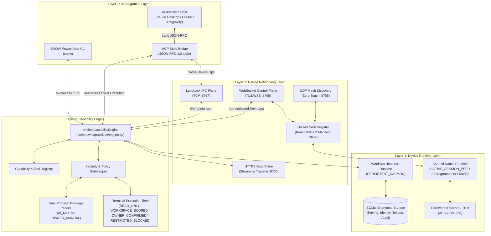

# SNOW V2 — Architecture Specification
## AI-Native Symmetric Cross-Device Capability Platform (Phases 11–18)

> **Document Status**: APPROVED SPECIFICATION (Phase 11 Baseline)
> **Evolutionary Context**: Builds on the frozen SNOW V1 foundation (Git tag `v1.0.0` / `snow-v1`, commit `f37626c`) and Phase 8–10 bidirectional milestones (commit `e13bf4a`).
> **Authors**: Project Owner (Ayush), Project Engineer (Frost), Senior Architectural Reviewer (Argon)
> **Academic Context**: B.Tech 7th/8th Semester Computer Science and Engineering Capstone Project.

---

## 1. Executive Summary & Core Architectural Invariants

### 1.1 The V1 Foundation vs. V2 Mesh
SNOW V1 established a secure, headless capability bridge connecting a Windows PC to an Android smartphone. V1 operated predominantly under an **asymmetric client-server topology**:
- The Windows PC acted as a central server (`SnowCoreServer`) hosting a WebSocket server (`SnowWebSocketServer`) and an MCP stdio bridge (`SnowMcpBridge`).
- The Android smartphone operated as a client/peer peripheral that paired with the PC and responded to capability inquiries (telemetry, clipboard, apps, notifications).

SNOW V2 evolves the architecture from an asymmetric client-server bridge into an **AI-Native Symmetric Cross-Device Capability Platform**. In V2:
1. **DeviceNode Abstraction**: Every device—whether a high-performance Windows workstation, a Linux server, or a battery-constrained Android smartphone—implements a standardized `DeviceNode` contract.
2. **Dual-Principal Privilege Model**: Strict security separation between automated AI agents (`AI_MCP`) operating under least privilege and human device owners (`OWNER_MANUAL`) possessing explicit confirmed physical authority.
3. **Dynamic Network Resilience**: Absolute zero-hardcoding of network endpoints. The system gracefully tracks shifting network topologies across Wi-Fi LANs, mobile hotspots, campus networks, and direct interfaces through dynamic reachability state machines.
4. **Local-First Capability Execution**: Local Windows operations must work independently of the desktop networking daemon. An AI assistant or local developer interacting via MCP or CLI must never be blocked from local capability execution just because the background networking daemon is stopped.
5. **Unified Capability Engine**: Complete elimination of divergent execution paths across IPC, WebSocket, and CLI interfaces, unifying all capability routing, policy checks, and auditing under a single Layer 2 `CapabilityEngine`.

---

## 2. The Four Logical Layers



---

### 2.1 Layer 1: AI Integration Layer

**Relevant Modules**: `src/snow/mcp/`, `src/snow/cli.py`

The AI Integration Layer is the primary boundary between AI assistants (such as Antigravity, Claude Desktop, Cursor) or human CLI operators and the SNOW device platform.

#### 2.1.1 MCP Protocol & Stdio Stream Isolation
- **Protocol**: Standard Model Context Protocol (MCP) using JSON-RPC 2.0 over standard input/output (`stdio`).
- **Stdio Invariant**: `stdout` is exclusively reserved for valid MCP JSON-RPC protocol frames. Any textual debugging output, log message, or third-party print statement on `stdout` corrupts the JSON stream and breaks the AI client.
- **Logging Rule**: All application logs, network diagnostics, and audit traces are directed to `sys.stderr` or persisted to `~/.snow/logs/snow.log`.
- **Tool Taxonomy**: Tools are exposed with clean JSON schemas, clear documentation, typed inputs, and standardized error responses.
- **Adapter Principle**: MCP is purely an adapter, not the owner of capability implementations. MCP handlers must never duplicate capability logic or independently implement security checks.

#### 2.1.2 SNOW CLI
The `snow` CLI provides administrative management, pairing initialization, daemon lifecycle control, and direct command execution for human developers without requiring an AI assistant. The CLI invokes the shared `CapabilityEngine` directly.

---

### 2.2 Layer 2: Capability Engine

**Planned Central Module**: `src/snow/capabilities/engine.py`

The Capability Engine governs all operations executed on any node in the SNOW mesh. It unifies capability resolution, shared Windows capability instances, principal-aware authorization, security policy enforcement, structured execution results, and terminal execution security tiers.

#### 2.2.1 Unified Three-Path Execution Model
The Capability Engine serves as the single execution and authorization boundary across three distinct caller paths:

1. **Local Windows MCP Operation (In-Process)**:
   ```
   AI Host → MCP Bridge → CapabilityEngine (in-process) → Windows Runtime
   ```
   *Requirement*: This path must work immediately and reliably even when the desktop networking daemon is completely stopped. No daemon auto-spawn or network dependency is required for local Windows operations.
2. **Remote Windows Operation through Authenticated WSS**:
   ```
   Remote Device → WSS Server → CapabilityEngine → Windows Runtime
   ```
   *Requirement*: Context is securely derived from the authenticated WSS session (`OWNER_MANUAL` or `PEER`).
3. **Local MCP Operation through IPC (where applicable)**:
   ```
   MCP Host → Authenticated IPC → CapabilityEngine → Windows Runtime
   ```
   *Requirement*: Context is stamped strictly as `AI_MCP` with zero inheritance of remote owner privileges.

#### 2.2.2 Dual-Principal Privilege Model
SNOW rejects the naive assumption that all requests share equal trust. Every execution context resolves strictly to one of two principal types:

| Principal Dimension | `AI_MCP` (Automated Agent) | `OWNER_MANUAL` (Human Device Owner) |
| :--- | :--- | :--- |
| **Origin** | Autonomous AI host via MCP stdio/IPC | Authenticated smartphone with Owner PIN |
| **Trust Model** | Least-privilege, automated, bounded | Explicit human physical authority |
| **Filesystem Access** | Scoped to configured approved workspace roots | Multi-drive access (`C:\`, `D:\`), excluding `.snow` keys |
| **Terminal Execution** | Strict security tiers (`READ_ONLY`, `WORKSPACE_SCOPED`) | Allowed across system with confirmed dialog (`OWNER_CONFIRMED`) |
| **Messaging (SMS)** | Intent-mode only (`ACTION_SENDTO`) | Intent-mode or explicit on-device send |
| **Session Lifetime** | Local invocation / IPC connection lifetime | Authenticated TLS session with heartbeat |

**Critical Invariant**: Never trust client-supplied principal, trust tier, authorization, or confirmation fields. An AI request must never acquire owner privilege merely because it requests confirmation.

#### 2.2.3 Structured Terminal Execution Security Tiers
Command execution on Windows nodes is partitioned into four explicit security tiers:

1. **Tier A — `READ_ONLY`**:
   - Safe inspection and diagnostic commands permitted to `AI_MCP` within approved roots.
   - Examples: `dir`, `Get-ChildItem`, `type`, `Get-Content`, `whoami`, `ipconfig`, `systeminfo`, `git status`, `git log`, `git diff`, `python --version`.
   - Validates command structure, arguments, executable resolution, and working directory (no naive substring allowlists).
2. **Tier B — `WORKSPACE_SCOPED`**:
   - AI workspace operations permitted only within approved roots (`Home`, `Desktop`, `Documents`, `Downloads`).
   - Enforces canonical path validation, traversal protection, and safe working-directory checks.
   - Blocks encoded PowerShell execution (`-EncodedCommand`, `-enc`), registry tampering, privilege escalation, and access to protected `.snow` credentials.
3. **Tier C — `OWNER_CONFIRMED`**:
   - For an authenticated `OWNER_MANUAL` execution context with valid explicit confirmation.
   - Permits user-level execution across valid Windows directories and drives, preserving native Windows permissions.
   - Does NOT request UAC elevation or bypass OS access controls.
   - Confirmation must be validated by an engine-backed ticket validator; a client-supplied `confirmed=true` boolean or arbitrary string never independently authorizes execution. Confirmation tickets are single-use, cryptographically bound, and time-bounded.
4. **Tier D — `RESTRICTED_BLOCKED`**:
   - Catastrophic or prohibited operations hard-blocked permanently for ALL principals (including `OWNER_MANUAL`).
   - Examples: disk formatting (`format`, `diskpart`), recursive deletion of protected system locations (`rmdir /s /q C:\Windows`, `Remove-Item -Recurse -Force C:\`, forward-slash paths, format switches), registry destruction, firewall disabling, access to `.snow` cryptographic credentials.
   - Rejections return structured errors with status `POLICY_DENIED`.

---

### 2.3 Layer 3: Device Networking Layer

**Relevant Modules**: `src/snow/network/`, `src/snow/transfer/`, security & identity modules

The Device Networking Layer maintains reliable, secure, local-first connectivity between heterogeneous devices over shifting network topologies.

#### 2.3.1 Dynamic Connectivity & Multi-Transport Routing
- **Zero Endpoint Hardcoding**: Network addresses (`10.x.x.x`, `192.168.x.x`, `172.x.x.x`) are treated as ephemeral session properties. Never hardcode IP addresses.
- **Dynamic Topology Adaptation**: Devices may connect via phone hotspot, home Wi-Fi, hostel/lab Wi-Fi, or direct LAN connections. Interface transitions trigger automatic discovery updates and socket rebinding without invalidating pairing records.
- **Port Allocation**:
  - **Port 8765 (WSS Control Plane)**: TLS 1.3 / WSS WebSocket server handling JSON-RPC control messages, capability requests, heartbeats, and real-time telemetry.
  - **Port 8766 (HTTPS Data Plane)**: Asynchronous HTTP/HTTPS file streaming server supporting chunked transfer, pre-authenticated token validation, and SHA-256 integrity checks.
  - **Port 8767 (Loopback IPC Plane)**: Local TCP IPC bridge strictly bound to `127.0.0.1` for inter-process communication between `snow.mcp` and `SnowCoreServer`.
  - **Port 8768 (UDP Discovery Plane)**: UDP multicast/broadcast listener for zero-touch peer discovery and targeted wake bursts.

#### 2.3.2 Reachability State Machine
A device in the SNOW mesh exists in one of four formal reachability states:
1. **`ONLINE_DIRECT`**: Active, authenticated, bi-directional WSS connection on port 8765. Latency < 50ms.
2. **`ONLINE_ROUTED`**: Active connection routed through an intermediate mesh node when direct IP path is blocked by client isolation.
3. **`DORMANT_REACHABLE`**: Device socket closed (e.g., Android in Doze mode), but UDP discovery beacons or wake listeners confirm network presence. Transition to `ONLINE_DIRECT` via wake burst.
4. **`OFFLINE`**: No active socket, no beacon response for > 30 seconds. Invocations return `DEVICE_OFFLINE`.

---

### 2.4 Layer 4: Device Runtime Layer

The Device Runtime Layer handles platform-specific OS interactions, persistence, process lifecycles, and security sandboxing.

#### 2.4.1 Windows Headless Runtime
- Runs headless as a native Python 3.13 process (`PERSISTENT_DAEMON` reachability profile).
- No mandatory Windows GUI, tray applications, or heavyweight frameworks. Idle RAM target < 30 MB.
- Stores pairing records, trusted device keys, and audit logs in SQLite (`~/.snow/snow_devices.db`) with write-ahead logging (WAL).
- Manages TLS 1.3 certificates (`~/.snow/tls/server.crt`, `~/.snow/tls/server.key`).

#### 2.4.2 Android Native Runtime
- Implemented in modern Kotlin targeting API 34 (Android 14) baseline with forward compatibility for Android 15 and 16 (`ACTIVE_SESSION_PEER` reachability profile).
- **Foreground Host Mode**: Quarantined in Phase 19A (client-only mode until Phase 20 production embedded WSS server).
- **Foreground Service**: Runs `SnowForegroundService` with foreground service type `connectedDevice` under strict Android 14+ requirements.
- **Cryptographic Security**: Android Keystore manages hardware-backed keys. Sensitive pairing tokens are encrypted with AES-256-GCM and stored in private SharedPreferences (never plaintext).
- **Graceful Lifecycle Management**: Handles Android Doze mode, app standby buckets, screen-off throttling, and network transitions without making false permanent connectivity claims.

---

## 3. Platform-Independent `DeviceNode` Contract

Every participating device in SNOW V2 conforms to the standard `DeviceNode` data model:

```json
{
  "node_id": "81a8c2c4-a554-4a0c-825a-c959713cf95e",
  "name": "Pixel 8",
  "platform": "android",
  "os_version": "Android 14 (API 34)",
  "trust_tier": "owner",
  "reachability_state": "CONNECTED_SESSION",
  "active_endpoints": [
    "wss://10.114.119.23:8765"
  ],
  "capabilities": {
    "manifest_version": "2.0",
    "supported_capabilities": [
      "android.telemetry.get",
      "android.clipboard.get",
      "android.clipboard.set",
      "android.apps.list",
      "android.apps.launch",
      "android.notifications.push",
      "android.messaging.send_intent",
      "android.files.transfer",
      "android.ringer.ring"
    ]
  },
  "last_seen_epoch": 1794940500
}
```

---

## 4. Android 17 Permission & Execution Matrix

Android OS security updates (API 34 through 36+) introduce strict limitations on background execution, clipboard access, and hardware identifiers. The following matrix governs all Android-side capabilities:

| Capability Identifier | Execution Classification | Prerequisites & OS Constraints | Failure Fallback Mode |
| :--- | :--- | :--- | :--- |
| `android.telemetry.get` | `BACKGROUND_SAFE` | No special permissions. Queries `BatteryManager`, `StatFs`, `ActivityManager`. | Always succeeds; returns partial metrics if restricted. |
| `android.notifications.push` | `BACKGROUND_SAFE` | Requires `POST_NOTIFICATIONS` permission (granted at pairing). | Logs notification error; returns `PERMISSION_DENIED`. |
| `android.clipboard.set` | `BACKGROUND_SAFE` | Foreground Service running. Updates system `ClipboardManager`. | Returns `CLIPBOARD_SET_FAILED`. |
| `android.clipboard.get` | `FOREGROUND_USER_INTERACTION_REQUIRED` | Android 10+ restricts background clipboard reading. App must be in foreground AND user must tap UI confirmation. | Rejects with `FOREGROUND_REQUIRED` or `USER_CONFIRMATION_REQUIRED`. |
| `android.apps.list` | `BACKGROUND_SAFE` | Requires `<queries>` launcher intent declaration in `AndroidManifest.xml` (API 30+). | Returns empty app list if query declaration missing. |
| `android.apps.launch` | `FOREGROUND_USER_INTERACTION_REQUIRED` | Starts activity via `FLAG_ACTIVITY_NEW_TASK`. Target package must be on user-approved allowlist. | Rejects with `POLICY_DENIED` or `APPLICATION_NOT_FOUND`. |
| `android.messaging.send_intent` | `FOREGROUND_USER_INTERACTION_REQUIRED` | Dispatches `Intent(ACTION_SENDTO)` with `sms:` URI. Final send requires user tapping 'Send' in SMS app. Direct SMS is unsupported. | Fails if no SMS handling app found. |
| `android.files.transfer` | `RUNTIME_PERMISSION_REQUIRED` | Transfers scoped to app-specific directory or `Environment.DIRECTORY_DOWNLOADS/SNOW`. | Rejects with `STORAGE_ACCESS_DENIED`. |
| `android.ringer.ring` | `BACKGROUND_SAFE` | Rings phone with alarm/notification audio stream for 1-15 seconds. | Returns error if media player fails. |

---

## 5. Phase 0–10 Codebase Gap Audit & Remediation Plan

### 5.1 Component Inventory & Current Roles
- `src/snow/core/server.py` (`SnowCoreServer`): Orchestrates daemonic startup, binds WebSocket, HTTP file transfer, UDP discovery, and IPC servers.
- `src/snow/network/ws_server.py` (`SnowWebSocketServer`): Implements WSS server, client pairing handshake, session persistence, heartbeat monitoring, and desktop action handling.
- `src/snow/mcp/bridge.py` (`SnowMcpBridge`): Connects to local IPC daemon or executes local Windows capabilities in-process.
- `src/snow/core/ipc.py` (`McpIpcBridgeServer`): Loopback TCP server on port 8767 translating IPC commands into capability calls.
- `src/snow/security/policy.py` & `context.py`: Defines `PeerCapabilityPolicy`, `SecurityPolicy`, and immutable `ExecutionContext`.

### 5.2 Architectural Duplications & Remediations
1. **Divergent Capability Execution (GAP-1)**:
   - *Current State*: `ws_server.py` executes Windows capabilities (`apps.py`, `files.py`, `terminal.py`) directly within its WebSocket dispatch loop; `ipc.py` executes Windows capabilities via a separate dispatch loop for MCP requests; `bridge.py` executes them via a third path.
   - *Phase 12 Remediation*: Extract all capability execution, policy checks, and error normalization into a unified `CapabilityEngine` (`src/snow/capabilities/engine.py`) shared identically across WSS, IPC, MCP Bridge, and CLI.
2. **Device State Coupling (GAP-2)**:
   - *Current State*: Active device sessions are tracked in memory inside `SnowWebSocketServer._authenticated_clients`; mesh discovery states are tracked separately inside `SnowDiscoveryService._discovered_peers`.
   - *Phase 13 Remediation*: Consolidate active and discovered devices into a unified `NodeRegistry` backed by SQLite and reachability states.
3. **Duplicated In-Process Dispatch & Capability Coupling in Bridge (GAP-3)**:
   - *Current State*: `SnowMcpBridge` instantiates local capability classes (`WindowsTelemetry`, `WindowsFileManager`, etc.) directly and contains bespoke in-process dispatch wrappers (`_execute_local_or_ipc`) with duplicated error normalization and policy checks.
   - *V2 Approved Architecture (Local-First Preservation)*: The local-first invariant must be preserved: AI assistants must be able to perform local Windows operations (reading files, checking telemetry, launching apps, clipboard) via MCP completely offline without the networking daemon running. The flaw in the current bridge is not that it supports in-process local execution, but that it maintains a duplicate execution path alongside the daemon. In Phase 12, `SnowMcpBridge` delegates local operations directly to the shared `CapabilityEngine` running in-process (stamped as `AI_MCP`). The background networking daemon is required only for cross-device operations (Android communication, mesh discovery, remote transfer).

---

## 6. Forward Roadmap (Phases 11–18)

| Phase | Approved Title | Main Objective |
| :--- | :--- | :--- |
| **11** | V2 Four-Layer Architecture Specification & Codebase Gap Audit | Architecture and gap documentation |
| **12** | Layer 2 Unified `CapabilityEngine` & Structured Terminal Security Tiers | Shared execution engine and terminal security tiers |
| **13** | Layer 3 Unified `NodeRegistry` & Platform-Independent `DeviceNode` Capability Manifest Protocol | Unified device state and capability manifest |
| **14** | Multi-Transport Reachability State Machine & Automatic On-Demand Session Routing | Dynamic connectivity and routing |
| **15** | Android 17 OS Execution Contract, Permission Matrix & Cross-Device Sync Hardening | Android runtime compliance and synchronization |
| **16** | Symmetric Peer-to-Peer Mesh | Windows ↔ Windows and Android ↔ Android Foreground Host/Client Mode |
| **17** | One-Command Onboarding & Multi-Host AI Integrations | Claude, ChatGPT, Gemini, and `snow devices` CLI |
| **18** | End-to-End Product Acceptance, Low-Spec Resource Verification & `snow-v2` Release | Product acceptance, below-30-MB idle RAM target, and release |
